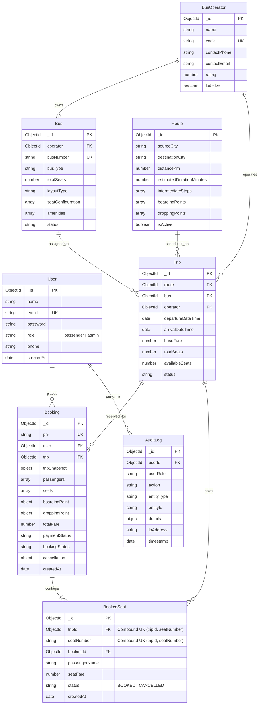

# Bus Booking Management System — Architecture & System Design Document
**Candidate Project for Algions AI Labs Full-Stack Web Development Assessment**

---

## 1. Executive Summary & Architecture Overview

The **Bus Booking Management System** is architected as a robust, production-grade **Modular Monolith** using the MERN stack (Node.js, Express.js, MongoDB/Mongoose, React.js with Vite and Tailwind CSS).

The application strictly enforces:
- **Role-Based Access Control (RBAC)** distinguishing Passengers and Administrators.
- **ACID Transaction-safe Double-Booking Prevention** through database-level compound unique indexes and atomic reservation logic.
- **Multi-tiered Cancellation & Simulated Refund Engine** adhering to configurable time-decayed penalty rules.
- **Real-Time Operational Analytics** powered by MongoDB aggregation pipelines.
- **Automated Audit Logging** tracking administrative and transactional operations without leaking sensitive data.

```
+-------------------------------------------------------------------------------+
|                                CLIENT LAYER                                   |
|   React 18 (Vite) + Tailwind CSS + Lucide Icons + Recharts + React Router DOM  |
+---------------------------------------+---------------------------------------+
                                        | (HTTPS / REST + JSON / JWT)
+---------------------------------------v---------------------------------------+
|                             API GATEWAY / SERVER                              |
|   Express 4 + Helmet + CORS + Morgan + Centralized Error & 404 Middleware     |
+---------------------------------------+---------------------------------------+
                                        |
+---------------------------------------v---------------------------------------+
|                             MIDDLEWARE LAYER                                  |
|   - authMiddleware (JWT Verification, Role Enforcement)                       |
|   - validateMiddleware (express-validator schema checks)                      |
|   - errorMiddleware (Centralized Error & Mongoose Mapping)                    |
+---------------------------------------+---------------------------------------+
                                        |
+---------------------------------------v---------------------------------------+
|                            CONTROLLERS LAYER                                  |
|   Thin HTTP dispatchers: Auth, Bus, Route, Trip, Booking, Report, Audit       |
+---------------------------------------+---------------------------------------+
                                        |
+---------------------------------------v---------------------------------------+
|                             SERVICES LAYER                                    |
|   Pure Business Logic: BookingEngine, CancellationEngine, Search, Analytics  |
+---------------------------------------+---------------------------------------+
                                        |
+---------------------------------------v---------------------------------------+
|                             DATABASE LAYER                                    |
|   MongoDB + Mongoose Models + Transactions + Compound Indexes                 |
|   [User, BusOperator, Bus, Route, Trip, BookedSeat, Booking, AuditLog]        |
+-------------------------------------------------------------------------------+
```

---

## 2. Database Design & Entity Relationship (ER) Diagram

### 2.1 Entity Relationship Diagram (Mermaid)



---

## 3. Double Booking Prevention Strategy (Deep Dive)

A critical requirement of the assessment is **absolute guarantee against double booking**: two simultaneous requests must never be allowed to reserve the same seat on the same trip.

### Three Layers of Defense:
1. **Application Layer Availability Check**: Fast-path verification in `bookingService` confirming the requested seats are not flagged as reserved.
2. **Atomic MongoDB Unique Constraint Insertion (`BookedSeat`)**:
   - The `BookedSeat` collection enforces a **compound unique index**:
     ```javascript
     BookedSeatSchema.index({ tripId: 1, seatNumber: 1 }, { unique: true });
     ```
   - When user A and user B concurrently submit a booking for seat `L1` on `trip_123`, both queries execute `insertMany` or write operations into `BookedSeat`.
   - The MongoDB storage engine uses document-level locking on the unique index. Exactly **one** write succeeds. The second write immediately triggers an `E11000 duplicate key error`.
3. **Transaction Session Rollback**:
   - Using MongoDB sessions (`session.startTransaction()`), if a duplicate key error is caught during seat reservation, the transaction is immediately aborted.
   - The second user receives an immediate **HTTP 409 Conflict** with:
     ```json
     {
       "success": false,
       "message": "One or more selected seats ([L1]) are no longer available. Please select another seat."
     }
     ```
   - No orphaned `Booking` or partial `BookedSeat` records exist in the database.

---

## 4. Cancellation & Refund Policy Engine

Cancellations simulate real-world refund processing with time-based tiered penalties:

| Cancellation Timing | Penalty Percentage | Refund Percentage | Refund Status |
|---|---|---|---|
| **> 24 hours before departure** | 20% | 80% | PROCESSED |
| **Between 12 and 24 hours before departure** | 50% | 50% | PROCESSED |
| **< 12 hours before departure or past departure** | 100% | 0% | NONE / REJECTED |

### Idempotency & Seat Release
- The cancellation workflow runs within a database transaction or atomic document lock.
- If the booking status is already `CANCELLED`, the endpoint returns a 400 Bad Request ("Booking is already cancelled").
- Upon successful cancellation:
  1. The booking status changes to `CANCELLED`.
  2. Cancellation metadata (cancellation fee, refund amount, refund timestamp) is recorded.
  3. Corresponding records in `BookedSeat` are removed, immediately making those seats available for other passengers to search and book.
  4. The `availableSeats` counter on the `Trip` document is incremented.
  5. An `AuditLog` entry is dispatched.

---

## 5. Development Plan & Implementation Roadmap

```
+-----------------------------------------------------------------------+
| Phase 1: Architecture, Project Structure & Foundation (COMPLETED)     |
| - Requirements analysis, directory scaffolding, tools verification   |
| - Express app, test harness, health check, architecture document      |
+-----------------------------------------------------------------------+
                                   |
+----------------------------------v------------------------------------+
| Phase 2: Database Models & Authentication / Authorization              |
| - User, BusOperator, Bus, Route, Trip, BookedSeat, Booking, AuditLog  |
| - bcrypt hashing, JWT issuance & verification, RBAC middleware        |
| - Auth test suite (register, login, bad pass, role check)             |
+-----------------------------------------------------------------------+
                                   |
+----------------------------------v------------------------------------+
| Phase 3: Core Catalog — Bus, Route & Trip Scheduling                  |
| - Bus Operator & Bus management (with 2+2 & 2+1 layout configurations)|
| - Route management with intermediate stops, boarding & drop points    |
| - Trip scheduler, search engine with multi-factor filters & sorting   |
+-----------------------------------------------------------------------+
                                   |
+----------------------------------v------------------------------------+
| Phase 4: Interactive Seat Selection & Double-Booking-Proof Booking    |
| - Interactive Deck & Seat visual selection UI                         |
| - Atomic reservation engine with BookedSeat compound unique index     |
| - Unique PNR generation, ticket confirmation & PDF/Printable ticket   |
| - Concurrent conflict tests (409 Conflict handling)                   |
+-----------------------------------------------------------------------+
                                   |
+----------------------------------v------------------------------------+
| Phase 5: Cancellation & Simulated Refund Engine                       |
| - Idempotent cancellation endpoint with time-decayed refund policy    |
| - Seat release verification and audit trail                           |
| - Passenger "My Bookings" & ticket cancellation flow                  |
+-----------------------------------------------------------------------+
                                   |
+----------------------------------v------------------------------------+
| Phase 6: Admin Dashboard, Analytics, Manifests & Audit Logs           |
| - Real aggregated metrics: Occupancy %, Revenue, Total Bookings       |
| - Recharts visual analytics (trends, route popularity)                |
| - Trip passenger manifest export & booking management                 |
| - AuditLog viewer for full operational traceability                   |
+-----------------------------------------------------------------------+
                                   |
+----------------------------------v------------------------------------+
| Phase 7: Complete End-to-End Testing, Polish, Demo Data & Docs        |
| - Comprehensive Jest + Supertest suites (Auth, Book, Conflict, Cancel)|
| - Comprehensive seed script with realistic Indian bus routes          |
| - Professional Swagger UI, README.md, Technical Report & Demo Guide   |
+-----------------------------------------------------------------------+
```

