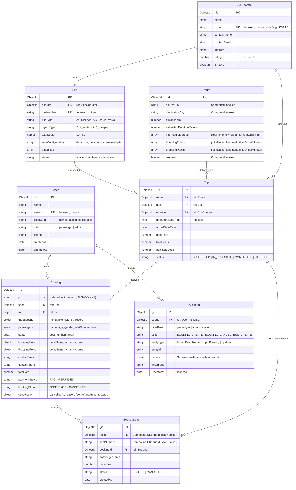

# Entity-Relationship (ER) Diagram & Schema Specifications

This document outlines the database schema, entity relationships, integrity constraints, and indexing strategy for the **Bus Booking Management System** (Algions AI Labs Internship Assessment).

---

## 1. Visual Entity-Relationship Diagram (Mermaid)



---

## 2. Key Architectural Constraints & Compound Indexes

### 2.1 The Double-Booking Prevention Compound Unique Index
To guarantee that two users can never book the exact same seat on the exact same trip:
```javascript
// BookedSeat Collection
BookedSeatSchema.index({ tripId: 1, seatNumber: 1 }, { unique: true });
```
- **Storage-Engine Enforcement**: Even if two HTTP requests arrive in parallel and pass the application-level availability check at the exact same millisecond, MongoDB's WiredTiger storage engine locks the index bucket on write.
- **Immediate Rejection**: One write commits, while the other raises an `E11000 duplicate key error` or `WriteConflict` transaction abort.
- **Clean Conflict Response**: The backend converts this error into an **HTTP 409 Conflict** error:
  `{ success: false, message: "One or more selected seats are no longer available. Please select different seats." }`

### 2.2 Search Optimization Index
```javascript
// Trip Collection
TripSchema.index({ route: 1, departureDateTime: 1, status: 1 });
```
- Accelerates passenger search queries matching route and calendar dates.

### 2.3 Route Origin-Destination Index
```javascript
// Route Collection
RouteSchema.index({ sourceCity: 1, destinationCity: 1, isActive: 1 });
```
- Enables instant case-insensitive route resolution.

### 2.4 PNR Uniqueness Index
```javascript
// Booking Collection
BookingSchema.index({ pnr: 1 }, { unique: true });
```
- Guarantees $O(1)$ ticket lookup and global uniqueness across millions of bookings.

